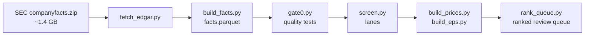

# edgar-store

**A local, refreshable store of SEC fundamentals for every US filer, plus a quality-first stock screener that tests the whole universe in under a second.**

[](https://github.com/imrsrfer/edgar-store/actions/workflows/ci.yml)


No database, no API keys, no paid data. Plain Parquet and CSV files built straight from SEC's own XBRL filings.

| | |
|---|---|
| Companies parsed | ~20,000 SEC filers |
| Facts in the store | ~3.6 million |
| Full facts build | ~1–2 minutes |
| Gate 0 screen, whole universe | under 1 second |
| Test suite | 700+ tests, run on every push |

---

## What it does

Most screeners start from price and multiples. This one starts from **earnings quality**. A company has to prove its reported numbers are real before anyone looks at valuation.

1. **Download** SEC's bulk `companyfacts.zip` (every XBRL fact every filer has reported).
2. **Normalise** it into one tidy table: one row per company, concept and period, with restatements and fiscal calendars handled.
3. **Gate 0**: run a fixed set of GAAP quality tests on every company.
4. **Screen**: send survivors through themed lanes (value, inflection, margin expansion, and more), price them, and rank one review queue.



## Gate 0: quality before valuation

Every test reads GAAP numbers, never management's adjusted figures. A missing input does **not** pass quietly. It produces `NOT_EVALUABLE` and the company is listed in `data_quality.csv`.

| Test | What it catches |
|---|---|
| `fail_fcf` / `fail_fcf_after_sbc` | Negative free cash flow, before and after stock-based pay is treated as a real cost |
| `fail_sbc` | Stock-based compensation above 15% of revenue (warning above 10%) |
| `fail_dilution` | Share count growing more than 2.5% a year |
| `fail_income_quality` | Operating cash flow far below net income |
| `fail_ni_over_oi` | Net income above operating income (one-off gains carrying the bottom line) |
| `fail_tax_anomaly` | Zero or negative effective tax rate inflating EPS |
| `fail_tangible_book` | Negative tangible book value (with a narrow exemption for buyback-driven cases) |

The store also publishes **data-integrity flags** for known XBRL failure modes, such as understated capex, stale share counts, share-scale breaks, misaligned TTM windows and revenue reported on a subset tag. Suspect numbers are held as not evaluable instead of being trusted.

Financials (SIC 6000–6799) are excluded by default, because free-cash-flow tests are meaningless for banks and insurers. Pass `--include-financials` to keep them.

## Quick start

```bash
git clone https://github.com/imrsrfer/edgar-store.git
cd edgar-store/code
python -m pip install -r requirements.txt

export EDGAR_ROOT=./data     # where the store is written (or pass --root to each stage)

python fetch_edgar.py        # ~15 min the first time, cached after
python build_facts.py        # ~1–2 min
python gate0.py              # < 1 s
python gate0.py --tickers MCRI,SKYW   # look at specific names
```

> **Before your first download:** SEC requires a User-Agent with a real contact. Set your own name and email in `USER_AGENT` in `code/edgar_lib.py`.

Want to skip the download? A pre-built store is committed in [`store/`](store/). Point any stage at it with `--root ../store`.

Full pipeline, every flag and the column reference: **[code/README.md](code/README.md)**.

## Repository layout

```
code/                 pipeline source, tests and the detailed manual
  fetch_edgar.py      SEC download (rate-limited, cached, resumable)
  build_facts.py      normalise XBRL into facts.parquet (supports --as-of point-in-time builds)
  gate0.py            Gate 0 quality tests and data-integrity flags
  screen.py           themed lanes over Gate 0 survivors
  build_prices.py     market caps and prices for survivors
  build_eps.py        forward/trailing EPS for the adjusted-EPS guard
  rank_queue.py       one ranked review queue
  tests/              frozen fixtures + integration tests against store/
store/                the latest published store (Parquet + CSV)
MANIFEST.json         build time, file hashes and test-gate result for the published store
.github/workflows/    CI: frozen tests (blocking) and integration tests
```

## How it stays honest

- **Point-in-time builds.** `build_facts.py --as-of YYYY-MM-DD` keeps only facts filed on or before a date, for backtests without look-ahead on filings.
- **Off-cycle fiscal years handled.** Built from bulk company facts, not the calendar-aligned frames API, which silently drops filers with non-December year-ends (over 15% of the universe).
- **Publication gate.** A rebuilt store is published only if the full test suite passes against it. Results are recorded in `MANIFEST.json`.
- **Regression tests for real failures.** Most tests pin a real company where the data once went wrong, so the same bug cannot come back.
- **Polite to SEC.** Declared User-Agent, rate limit under SEC's 10 req/s ceiling, backoff on errors.

## Tests

```bash
cd code
EDGAR_FROZEN=1 python -m pytest tests -m "not integration" -q   # network-free, what CI blocks on
python -m pytest tests -q                                         # everything, including the committed store
```

## Limitations

- XBRL is only as good as each filer's tagging. The integrity flags catch known failure modes, not all of them.
- Ticker maps are current, so historical (`--as-of`) builds still carry survivorship bias in the universe.
- Prices and EPS come from free sources and are a snapshot. Re-run `build_prices.py` before relying on any multiple.
- This is a research tool, not investment advice.

## Data and licence

Financial data comes from SEC EDGAR, which is public. No licensed or subscription data is stored in this repository.
